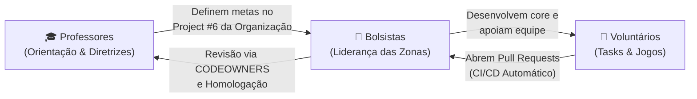

# 🏛️ Estrutura de Cargos, Subsistemas e Governança — ROBOLDO (LAR / UERN)

Este documento define os **cargos**, **responsabilidades por subsistema**, permissões no GitHub e fluxo de trabalho dos membros da organização **[ROBOLDO-UERN](https://github.com/ROBOLDO-UERN)** no **Laboratório de Automação e Robótica (LAR / UERN)**.

---

## 👥 Quadro de Cargos do Projeto

Os integrantes do ecossistema **Roboldo** estão organizados em três cargos principais, refletidos nas **Equipes (Teams)** da organização e no campo **`Cargo`** dos **[GitHub Projects da Organização](https://github.com/orgs/ROBOLDO-UERN/projects/6)**:

| Cargo | Team no GitHub | Campo no Project da Organização | Permissão nos Repositórios | Papel Principal |
| :--- | :--- | :--- | :--- | :--- |
| 🎓 **Professores** | `@ROBOLDO-UERN/professores` | `Professor` | `Admin` / `Maintain` | Coordenação geral, orientação científica e técnica, validação arquitetural e aprovação final de entregas/releases. |
| 🔬 **Bolsistas** | `@ROBOLDO-UERN/bolsistas` | `Bolsista` | `Write` (`Push`) | Desenvolvimento contínuo, liderança técnica das **Zonas de Projetos**, cumprimento de metas do plano de trabalho, revisão de código de voluntários e documentação. |
| 🤝 **Voluntários** | `@ROBOLDO-UERN/voluntarios` | `Voluntário` | `Triage` / `Write` | Colaboração ativa em tasks específicas das Zonas, desenvolvimento de features/jogos, modelagem 3D, testes em bancada e documentação. |

---

## 🧩 Mapa de Repositórios e Responsáveis (`CODEOWNERS`)

As tarefas não ficam presas a um único repositório: cada trabalho vive no repositório do seu **subsistema técnico**, enquanto a gestão e identificação dos trabalhos (`ORB-*`, `IOT-*`, `CTRL-*`, `SLAM-*`, `IA-*`, `VOZ-*`, `DISP-*`, `HW-*`, `CAD-*`, `LOJA-*`, `JOGO-*`) ficam centralizadas no **[Painel Geral da Organização (Project #6)](https://github.com/orgs/ROBOLDO-UERN/projects/6)**:

| Repositório | Subsistema | Equipes Responsáveis (`CODEOWNERS`) | Quadro da Zona na Organização |
| :--- | :--- | :--- | :--- |
| **[Roboldo-Orbit](https://github.com/ROBOLDO-UERN/Roboldo-Orbit)** | Controlador Geral, Orquestrador (Core/HAL) & SDK | `@zona-gamificacao-apps`, `@zona-mecanica-hardware`, `@professores`, `@bolsistas` | [Project #5](https://github.com/orgs/ROBOLDO-UERN/projects/5) & [Project #6](https://github.com/orgs/ROBOLDO-UERN/projects/6) |
| **[Roboldo-IoT-Firmware](https://github.com/ROBOLDO-UERN/Roboldo-IoT-Firmware)** | IoT & Firmware C/C++ (Dual-ESP32, PID, Sensores de Toque, E-Stop) | `@zona-mecanica-hardware`, `@professores`, `@bolsistas` | [Project #4](https://github.com/orgs/ROBOLDO-UERN/projects/4) & [Project #6](https://github.com/orgs/ROBOLDO-UERN/projects/6) |
| **[Controlador-Roboldo](https://github.com/ROBOLDO-UERN/Controlador-Roboldo)** | Algoritmo de Controlador em Python (Cinemática & Serial/Bluetooth) | `@zona-mecanica-hardware`, `@professores`, `@bolsistas` | [Project #4](https://github.com/orgs/ROBOLDO-UERN/projects/4) & [Project #6](https://github.com/orgs/ROBOLDO-UERN/projects/6) |
| **[Roboldo-IA-Movimento](https://github.com/ROBOLDO-UERN/Roboldo-IA-Movimento)** | IA Conversacional (STT/LLM), Voz (Piper TTS) & Movimento/SLAM em Python (v1.0 & v2.0) | `@zona-ia`, `@zona-voz`, `@zona-slam`, `@professores`, `@bolsistas` | [Projects #1](https://github.com/orgs/ROBOLDO-UERN/projects/1), [#2](https://github.com/orgs/ROBOLDO-UERN/projects/2), [#3](https://github.com/orgs/ROBOLDO-UERN/projects/3) & [#6](https://github.com/orgs/ROBOLDO-UERN/projects/6) |
| **[Roboldo-Base](https://github.com/ROBOLDO-UERN/Roboldo-Base)** | Jogos em Flutter (*Roboldo Educa*, TEA/CAA), Apps & Lojinha | `@zona-gamificacao-apps`, `@professores`, `@bolsistas` | [Project #5](https://github.com/orgs/ROBOLDO-UERN/projects/5) & [Project #6](https://github.com/orgs/ROBOLDO-UERN/projects/6) |
| **[Roboldo-Display-Nextion](https://github.com/ROBOLDO-UERN/Roboldo-Display-Nextion)** | Tela Nextion/DWIN (`.HMI`/`.TFT`), Imagens, Rostos & Lipsync | `@zona-voz`, `@zona-ia`, `@zona-mecanica-hardware`, `@professores` | [Project #2](https://github.com/orgs/ROBOLDO-UERN/projects/2) & [Project #6](https://github.com/orgs/ROBOLDO-UERN/projects/6) |
| **[Roboldo-Hardware-CAD](https://github.com/ROBOLDO-UERN/Roboldo-Hardware-CAD)** | Modelagem Mecânica CAD 3D, Chassi & Diagramas Elétricos | `@zona-mecanica-hardware`, `@professores`, `@bolsistas` | [Project #4](https://github.com/orgs/ROBOLDO-UERN/projects/4) & [Project #6](https://github.com/orgs/ROBOLDO-UERN/projects/6) |

---

## 🔄 Fluxo de Trabalho e CI/CD

1. **Identificação do Trabalho na Organização**: Toda Issue criada em qualquer repositório recebe no **[Project #6 da Organização](https://github.com/orgs/ROBOLDO-UERN/projects/6)** sua **Zona de Projeto**, **Subsistema / Parte**, **Cargo** e **Identificação do Trabalho** (código/vínculo acadêmico).
2. **Templates com CI/CD**: Para novos módulos, utilize um dos templates oficiais (`roboldo-template-python`, `roboldo-template-iot-cpp`, `roboldo-template-flutter-game`).
3. **Revisão (`CODEOWNERS`)**: Todo Pull Request aciona automaticamente o workflow de **CI/CD** da organização e solicita revisão da equipe responsável pelo subsistema.
