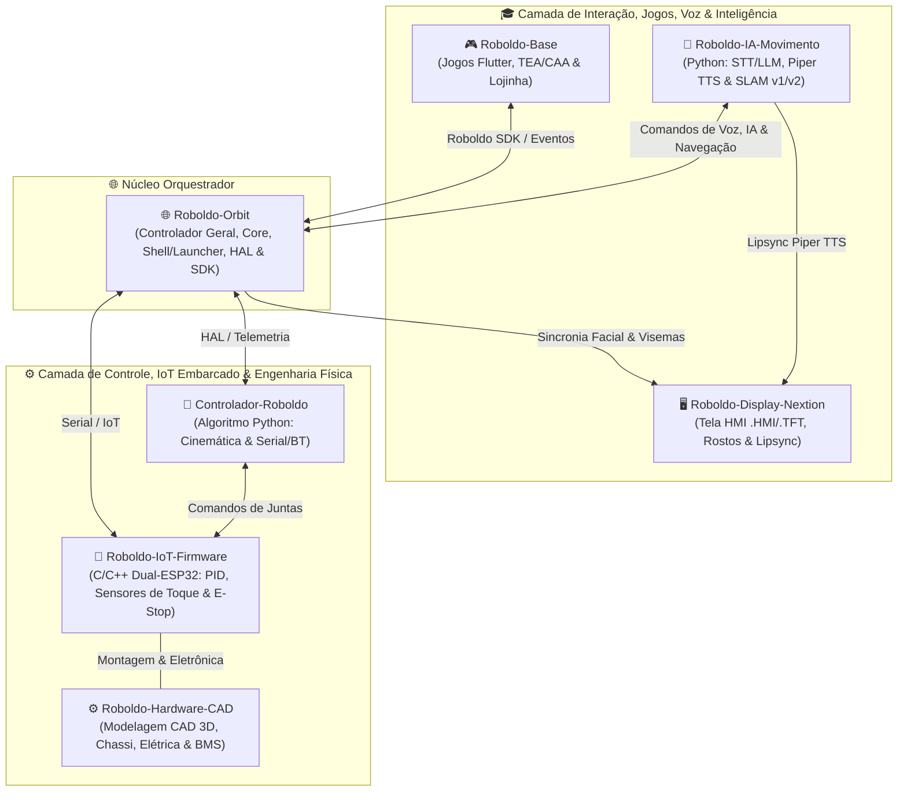

# 🤖 ROBOLDO — Ecossistema de Robótica Social (LAR / UERN)

**Laboratório de Automação e Robótica (LAR) • Universidade do Estado do Rio Grande do Norte (UERN)**  
*Educação • Acessibilidade (TEA/CAA) • Interação Humano-Robô (IHR) • Inteligência Artificial • Navegação Autônoma*

---

## 🏗️ Arquitetura Modular do Ecossistema Roboldo

O projeto **Roboldo** é dividido em **7 repositórios de subsistemas especializados**, coordenados pelo orquestrador central (**Orbit**) e validados continuamente por pipelines de **CI/CD** e **Branch Protection Rules**:

---

## 🧩 Mapa de Repositórios, CI/CD Ao Vivo & Equipes Responsáveis (`CODEOWNERS`)

Cada parte do Roboldo possui seu próprio repositório com **Branch Protection** na branch principal, revisão automática por equipe (`CODEOWNERS`) e testes automatizados:

| Subsistema / Repositório | Stack Principal | Status CI/CD | Códigos de Trabalho | Equipes Responsáveis (`CODEOWNERS`) |
| :--- | :--- | :---: | :--- | :--- |
| 🌐 **[Roboldo-Orbit](https://github.com/ROBOLDO-UERN/Roboldo-Orbit)** Controlador Geral, Orquestrador Central, HAL, Shell e SDK | Python / Core / Multi |  | `ORB-01` a `ORB-03` | `@zona-gamificacao-apps` `@zona-mecanica-hardware` `@professores` `@bolsistas` |
| 🔌 **[Roboldo-IoT-Firmware](https://github.com/ROBOLDO-UERN/Roboldo-IoT-Firmware)** IoT & Firmware Embarcado (Dual-ESP32, PID, Sensores de Toque, E-Stop) | C / C++ (PlatformIO / ESP32) |  | `IOT-01` a `IOT-03` | `@zona-mecanica-hardware` `@professores` `@bolsistas` |
| 🐍 **[Controlador-Roboldo](https://github.com/ROBOLDO-UERN/Controlador-Roboldo)** Algoritmo de Controlador de Juntas/Braços e Serial/Bluetooth | Python (Pygame / PySerial) |  | `CTRL-01` | `@zona-mecanica-hardware` `@professores` `@bolsistas` |
| 🧠 **[Roboldo-IA-Movimento](https://github.com/ROBOLDO-UERN/Roboldo-IA-Movimento)** IA Conversacional (STT/LLM), Voz (Piper TTS) e Movimento/SLAM (v1.0 & v2.0) | Python (LLM / Piper / SLAM) |  | `SLAM-01..03` `IA-01` • `VOZ-01` | `@zona-ia` `@zona-voz` `@zona-slam` `@professores` `@bolsistas` |
| 🎮 **[Roboldo-Base](https://github.com/ROBOLDO-UERN/Roboldo-Base)** Jogos Educativos em Flutter (*Roboldo Educa*, TEA/CAA), Mapa POIs & Lojinha | Flutter / Dart / Node / Python |  | `JOGO-01..02` `LOJA-01..04` `APPS-01` • `SLAM-04` | `@zona-gamificacao-apps` `@professores` `@bolsistas` |
| 🖥️ **[Roboldo-Display-Nextion](https://github.com/ROBOLDO-UERN/Roboldo-Display-Nextion)** Projeto da Tela Nextion/DWIN (`.HMI`/`.TFT`), Imagens de Rostos & Lipsync | Nextion HMI & Assets |  | `DISP-01` | `@zona-voz` `@zona-ia` `@zona-mecanica-hardware` `@professores` |
| ⚙️ **[Roboldo-Hardware-CAD](https://github.com/ROBOLDO-UERN/Roboldo-Hardware-CAD)** Modelagem Mecânica CAD 3D (`.STEP`/`.STL`), Chassi, Elétrica & BOM | CAD 3D & KiCad |  | `HW-01` • `CAD-01` | `@zona-mecanica-hardware` `@professores` `@bolsistas` |

---

## 🏛️ Gestão Centralizada na Organização (GitHub Projects)

As tasks e identificações de trabalhos **não ficam presas a um único repositório**: toda a gestão de pesquisa (TCCs, PIBIC, artigos e metas de desenvolvimento) ocorre nos **Projects da Organização**:

> 👉 **[Acessar Project #6 — ROBOLDO: Central Geral de Trabalhos & Subsistemas](https://github.com/orgs/ROBOLDO-UERN/projects/6)**  
> *Visão unificada de todas as 23 tasks com filtros por **Identificação do Trabalho**, **Subsistema / Parte**, **Zona de Projeto** e **Cargo**.*

| Zona / Grupo de Pesquisa | Escopo Técnico | Quadro da Zona na Organização | Team no GitHub |
| :--- | :--- | :--- | :--- |
| 🗺️ **Zona 1: SLAM & Navegação** | Mapeamento 2D (*Occupancy Grid*), fusão sensorial (LiDAR, Odometria e IMU), *Path Planning* e POIs. | [📋 Abrir Project Zona 1](https://github.com/orgs/ROBOLDO-UERN/projects/1) | `@ROBOLDO-UERN/zona-slam` |
| 🗣️ **Zona 2: Voz & Expressividade** | Síntese de voz neural offline (**Piper TTS** `pt-BR`), sincronia labial (*lipsync*), tela Nextion e rostos. | [📋 Abrir Project Zona 2](https://github.com/orgs/ROBOLDO-UERN/projects/2) | `@ROBOLDO-UERN/zona-voz` |
| 🧠 **Zona 3: Inteligência Artificial & IHR** | Conversação natural com IA (STT + LLM local/cloud), personalidade educativa do Roboldo e IHR. | [📋 Abrir Project Zona 3](https://github.com/orgs/ROBOLDO-UERN/projects/3) | `@ROBOLDO-UERN/zona-ia` |
| ⚙️ **Zona 4: Mecânica, Elétrica & Hardware** | Modelagem CAD 3D, elétrica/BMS, firmware IoT C/C++ (Dual-ESP32), controlador Python, toque e *E-Stop*. | [📋 Abrir Project Zona 4](https://github.com/orgs/ROBOLDO-UERN/projects/4) | `@ROBOLDO-UERN/zona-mecanica-hardware` |
| 🎮 **Zona 5: Gamificação, Apps & Lojinha** | Jogos educativos em Flutter (*Roboldo Educa*, TEA/CAA), controlador geral *Orbit*, SDK e **Lojinha**. | [📋 Abrir Project Zona 5](https://github.com/orgs/ROBOLDO-UERN/projects/5) | `@ROBOLDO-UERN/zona-gamificacao-apps` |

---

## 📋 Templates Oficiais para Novos Trabalhos (1-Click Setup)

Vai começar um novo módulo, algoritmo de pesquisa ou jogo para o Roboldo? Utilize um dos **Templates Oficiais da Organização** (já configurados com CI/CD, linters, `.gitignore` e `CODEOWNERS`):

| Template Oficial | Uso Recomendado | Status do Template |
| :--- | :--- | :---: |
| 🐍 **[`roboldo-template-python`](https://github.com/ROBOLDO-UERN/roboldo-template-python)** | Novos algoritmos em **Python** (IA, visão computacional, controle, voz ou SLAM) com `ruff` + `pytest`. |  |
| 🔌 **[`roboldo-template-iot-cpp`](https://github.com/ROBOLDO-UERN/roboldo-template-iot-cpp)** | Novos firmwares **IoT em C/C++** (PlatformIO / ESP32 / Arduino) com análise estática `cppcheck` e build `pio run`. |  |
| 🎮 **[`roboldo-template-flutter-game`](https://github.com/ROBOLDO-UERN/roboldo-template-flutter-game)** | Novos **jogos educativos e apps em Flutter** prontos para publicação na **Lojinha do Roboldo** (`roboldo-app.json`). |  |

---

## 👥 Estrutura de Cargos & Como Contribuir (Onboarding)

O laboratório organiza seus membros em três níveis integrados às **5 Zonas de Projetos** (detalhes em [`GOVERNANCE.md`](https://github.com/ROBOLDO-UERN/.github/blob/main/GOVERNANCE.md)):

| Cargo | Team da Organização | Permissão Base | Responsabilidade Principal |
| :--- | :--- | :--- | :--- |
| 🎓 **Professores** | `@ROBOLDO-UERN/professores` | `Admin` / `Maintain` | Coordenação geral, orientação científica, validação arquitetural e homologação de releases. |
| 🔬 **Bolsistas** | `@ROBOLDO-UERN/bolsistas` | `Write` / `Maintain` | Desenvolvimento dedicado, liderança técnica das Zonas, entregas de metas e revisão de PRs. |
| 🤝 **Voluntários** | `@ROBOLDO-UERN/voluntarios` | `Triage` / `Write` | Colaboração em tasks das Zonas, criação de jogos para a Lojinha, modelagem 3D, testes e documentação. |

### 🚀 Passo a Passo para Membros da Equipe:
1. **Escolha ou Crie seu Trabalho**: Acesse o **[Painel Geral da Organização (Project #6)](https://github.com/orgs/ROBOLDO-UERN/projects/6)** ou o Project da sua Zona e verifique o código da sua task (ex.: `IOT-03`, `JOGO-01`, `SLAM-02`).
2. **Crie uma Branch no Repositório do Subsistema**: Trabalhe em uma branch dedicada (`feat/nome-da-entrega` ou `fix/correcao`). A branch principal é protegida por **Branch Protection Rules**.
3. **Abra um Pull Request**: O GitHub acionará automaticamente o **CI/CD** da organização e solicitará a revisão da equipe responsável configurada no `CODEOWNERS`.

---

  🏛️ <b>Laboratório de Automação e Robótica (LAR)</b> — <b>Universidade do Estado do Rio Grande do Norte (UERN)</b> • Mossoró, RN, Brasil

